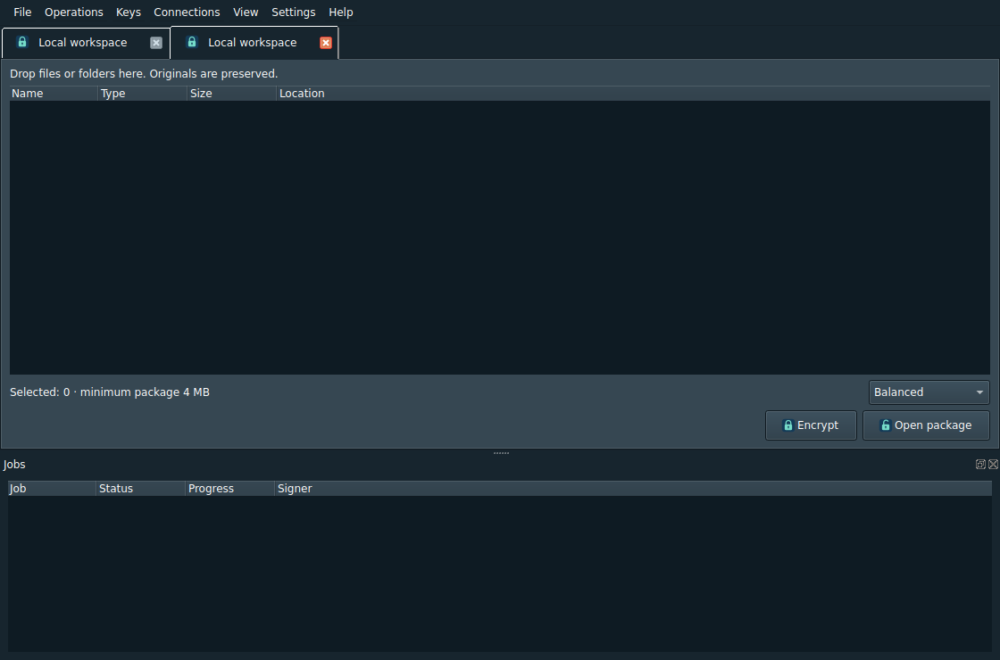

# ESCrypter

**A bilingual desktop application for encrypted file packages and remote jobs.**

[Turkce / Türkçe](README_TR.md) · [Format](FORMAT.md) · [Security](SECURITY.md) · [Contributing](CONTRIBUTING.md) · [Changelog](CHANGELOG.md)



ESCrypter targets Debian 13. It combines a Qt6 desktop with a Rust cryptographic
core and an optional per-user remote agent. The project is licensed under
**GPL-3.0-only**; third-party components retain their own licenses.

> **Development candidate — version 0.2.0.** Recorded checks were performed on
> Ubuntu 24.04 amd64. Debian 13, actual SSH/SFTP and desktop-session validation
> remain pending. No independent security audit has been completed. The included
> GitHub workflows have not yet run in this repository.

## Features

- Movable, closable tabs and categorized menus; English/Turkish UI.
- XZ compression followed by XChaCha20-Poly1305 authenticated stream encryption.
- Password-protected manifest, Argon2id key derivation and Ed25519 content signatures.
- Exactly 100 shuffled pieces in ten directories, packed into uncompressed TAR
  with an `.esc` extension. Minimum total package size: 4 MB, not 4 MB per piece.
- Signing-key management, recovery option, signer trust and authenticated previews.
- SFTP through libcurl; remote job control through the SSH-carried ECP protocol.
- Optional HTTPS downloads through GNU Wget; offline license viewer.

Splitting and shuffling are format choices, not additional cryptographic strength.
Signatures cover a canonical transcript of member paths, sizes and contents, not
literal TAR header bytes. A valid signature alone does not establish signer trust.
For server-side confidentiality, encrypt locally and upload the resulting archive.

## Build

Install dependencies on the target Debian/Ubuntu system:

```bash
sudo apt update
sudo apt install build-essential cargo rustc rustfmt cmake pkg-config python3 \
  qt6-base-dev qt6-svg-dev libsodium-dev liblzma-dev libcurl4-openssl-dev \
  openssh-client wget systemd
bash build.sh
```

The 35 resolved Rust dependency source trees are included in `vendor/` with
Cargo.lock. Cargo builds offline; installing system packages still needs a package
repository. License notices are regenerated from resolved sources and installed
system components. Qt resources embed the icons and license catalog.

## Test and package

```bash
bash tests/run-checks.sh
python3 tests/ecp_integration.py target/release
bash package-single-deb.sh --no-build
```

The combined package is `dist/ESCrypter_0.2.0-1_amd64.deb` on amd64 and contains
GUI, CLI and agent. The split packages remain available for server-only deployment.
To install the combined build on the machine where it has been validated:

```bash
sudo apt install ./dist/ESCrypter_0.2.0-1_amd64.deb
escrypter-gui
```

`tests/run-checks.sh` includes Rust tests, CLI integration and offscreen GUI smoke
checks. Socket tests fail or report unavailable if the host forbids Unix sockets;
that is not a pass. CI defines Ubuntu 24.04 and Debian 13 container jobs; neither
container checks real Wayland/X11 sessions nor a remote SSH/SFTP server.

## Validation and limits

Historical results: 14 Rust unit tests, 18 CLI integration tests, GUI smoke checks
and six encryption/decryption benchmark samples. See
[debug report](docs/DEBUG_REPORT_TR.md) and [archived logs](docs/validation/README.md).
They are distinct from future GitHub CI results. Some diagnostic strings are still
English; reopening tabs is needed for all labels after changing the language.

See [README_TR.md](README_TR.md) for usage and [docs/ECP.md](docs/ECP.md) for the
remote protocol. The server account can access plaintext during remote processing.

## Repository and releases

No compiled binaries or private user data belong in the source tree. Keep `.deb`
files in GitHub Releases, with source and license notices available. Build artifacts
and fresh test output are ignored by Git. Use prereleases until target-platform
and network validation is complete.

[GitHub upload guide (Turkish)](docs/GITHUB_YUKLEME_TR.md)

## License

[GPL-3.0-only](LICENSE). The previous MIT notice is retained in
`licenses/0.1.0-MIT.txt`. Vendored dependencies have their own notices; see
`THIRD_PARTY_NOTICES.txt` and the application's Open source licenses dialog.
